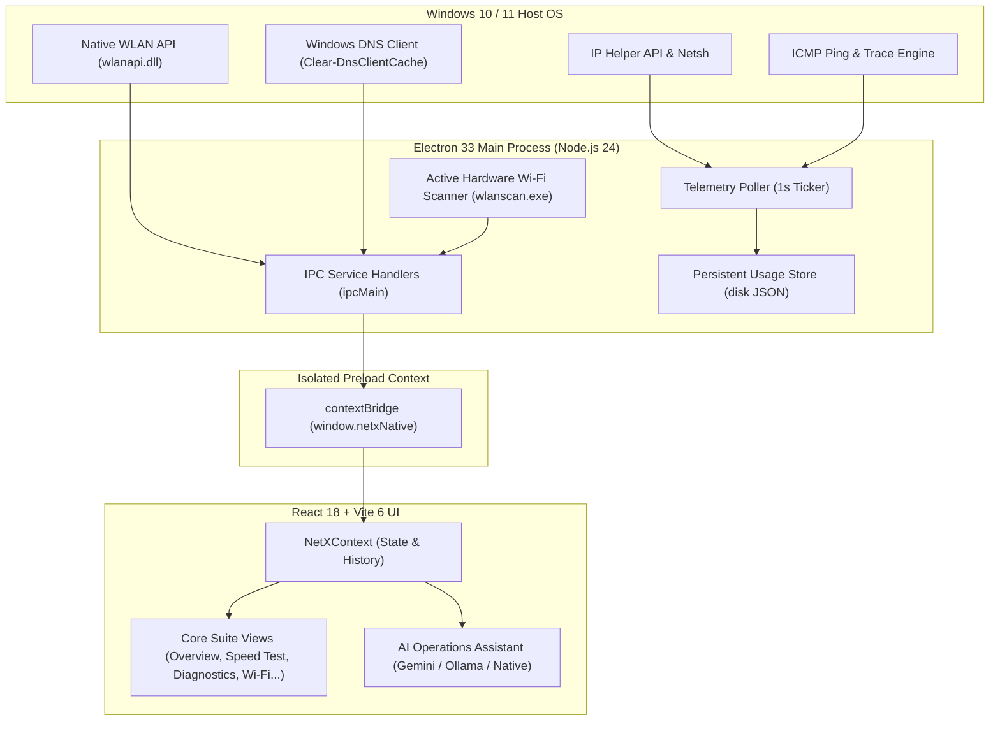

# NetX — System Architecture & Engineering Specification

## 1. Overview & High-Level Topology

NetX is engineered as a high-performance desktop network operations utility and real-time telemetry suite for 64-bit Windows environments. It bridges raw hardware network counters from the Windows operating system into a high-contrast dark technical interface designed according to the Taste Skill Data Terminal art direction.

---

## 2. Layered Architecture

### Layer 1: Native Windows Telemetry & Hardware Engine
- **Hardware Interface Polling**: Queries interface adapter byte counters delta (`rawRxBytes`, `rawTxBytes`) every 1,000ms. Discards single-second anomalies (>1 GB/s) to maintain telemetry integrity.
- **Active Wi-Fi Scanning**: Invokes Win32 `WlanScan` directly via `bin/wlanscan.exe` or PowerShell fallback to command the wireless NIC driver to broadcast probe requests on 2.4 GHz and 5 GHz channels.
- **Dual-Stage Gateway & DNS Probing**: Measures ICMP round-trip latency to the local default gateway and external DNS (`1.1.1.1` with `8.8.8.8` fallback) to distinguish local router disconnects from upstream WAN routing failures.
- **Non-Elevated DNS Resolver Flush**: Utilizes PowerShell's `Clear-DnsClientCache` cmdlet, enabling full DNS cache flushing without prompting for UAC administrator privileges.

### Layer 2: Preload Security Boundary
- Context isolation enabled (`contextIsolation: true`, `nodeIntegration: false`).
- All native capabilities exposed exclusively through typed `window.netxNative` APIs.
- No direct filesystem access or unverified shell execution permitted from the renderer process.

### Layer 3: Presentation & Taste-Skill UI
- **Design Tokens**: Charcoal base (`#0a0d12`), elevated card surfaces (`#11161d`, `#161c24`), electric cyan primary accents (`#0284c7`, `#0ea5e9`, `#38bdf8`), restrained emerald green for healthy states, amber warnings, and red failure alerts.
- **Typography & Precision**: High-contrast tabular numbers, 1px rules, no excessive glow or glassmorphism slop.
- **Dual Theme Support**: Dark-first technical mode with high-contrast slate light mode.

### Layer 4: AI Operations Bridge
- **Google Gemini Flash Lite**: Sub-second cloud reasoning with tool calling (`run_speed_test`, `list_wifi_networks`, `connect_wifi`, `ping_host`, `flush_dns`, etc.).
- **Local Ollama Integration**: Offline neural engine support (`llama3.2`, `mistral`, `qwen2.5-coder`).
- **Deterministic Native Fallback**: Zero-cloud offline regex intent engine ensuring basic operational queries work even during total internet blackouts.
